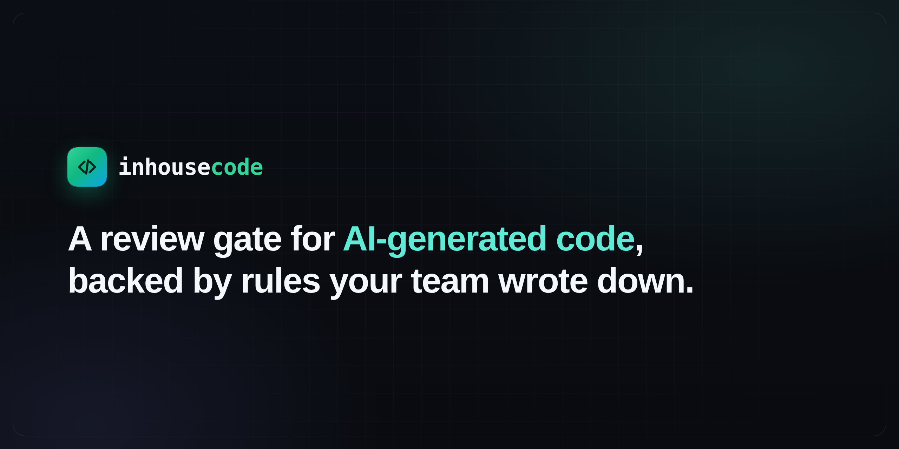
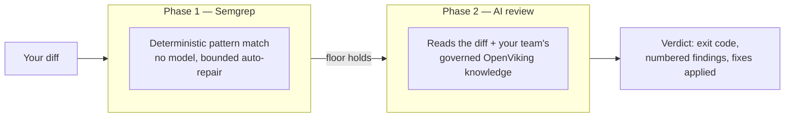

<h1 align="center">

</h1>

<p align="center">
<a href="docs/getting-started/"><strong>Getting Started</strong></a> •
<a href="docs/concept.md"><strong>Why inhousecode</strong></a> •
<a href="docs/business-case.md"><strong>Business Case</strong></a> •
<a href="docs/"><strong>Docs</strong></a> •
<a href="CONTRIBUTING.md"><strong>Contribute</strong></a> •
<a href="CODE_OF_CONDUCT.md"><strong>Code of Conduct</strong></a> •
<a href="LICENSE"><strong>License</strong></a>
</p>

<p align="center">
<a href="LICENSE"></a>
</p>

## About

> Reviewing code an AI wrote, with a tool that knows nothing about your team?
> **inhousecode is here to help.**

**inhousecode** is a two-phase code review gate built for teams shipping
AI-generated code: deterministic Semgrep first, then an AI reviewer using
governed knowledge **your team approves** — not a vendor's idea of clean code.

- A deterministic Semgrep floor runs before any model opines, with a
  bounded auto-repair loop (up to 20 rounds)
- The AI review receives a bounded OpenViking snapshot of approved project and
  global knowledge, with stable record IDs and provenance
- Blocking findings (CRITICAL/HIGH) get fixed and re-reviewed automatically;
  opinions (MEDIUM/LOW) get numbered and left to **you**, unless you opt into
  fixing every finding with `review.fixByDefault`
- Runs at `git commit`, or the moment your coding agent finishes a turn —
  before you ever see the diff
- For the final sign-off on a whole PR, an **adversarial review** (`--adversarial`)
  runs several critical lenses on a second model, then synthesizes one verdict —
  the thorough review you run before merge, not on every commit
- Candidate feedback is preserved, classified, and promoted only under explicit
  policy; high-impact changes require human approval



| Phase | Checks for | Decides |
|---|---|---|
| **1 — Semgrep** | Injection, hard-coded secrets, unsafe deserialization | Pattern matching; no model, so nothing to talk it out of a finding |
| **2 — AI review** | Everything else, against your team's own rules | A model, only once the floor already held |
| **Severity** | CRITICAL/HIGH → fixed automatically, re-checked | MEDIUM/LOW → numbered, left to **you** unless you opt into `--fix` |

## Current functionality

inhousecode currently offers the following capabilities.

### Code review gates

- **Static review with Semgrep** before the AI review.
- **AI code review** against governed project/global knowledge, repository
  context, intent, and the current change.
- **Two-phase verdicts**: static analysis runs before a model is allowed to
  review the code.
- **Blocking findings** for CRITICAL and HIGH issues.
- **Non-blocking findings** for MEDIUM and LOW issues, shown in a numbered
  table for developer decisions.
- **Bounded automatic repair** for eligible blocking findings, with an opt-in
  repository default that repairs all static and AI findings.
- **No-progress detection** so repair loops stop when they stop improving the
  result.
- **Mandatory re-review after every repair** before the verdict is final.
- **Adversarial review mode** with multiple critical lenses and a second
  opinion that can only remove or downgrade findings.
- **Explain mode** for opening a follow-up session about the latest findings.

### Review targets and intent

- Staged changes from the Git index.
- Uncommitted working-tree changes.
- A range of commits above a base reference with `--diff`.
- Pull requests with `--pr`, resolved through GitHub or Azure DevOps.
- A path or directory with `--path`.
- Pull-request tickets with `--ticket` when the tracker is supported.
- Free-form intent supplied with `--intent-file`.
- Report-only reviews with `--no-fix`.
- One-run `--fix` and repository-wide `review.fixByDefault` repair opt-ins;
  explicit `--no-fix` has precedence.
- Non-interactive gate mode with `--gate`.
- Full agent logs with `--verbose`.

### AI harnesses

The review engine uses a pluggable harness adapter. The currently supported
backends are:

- GitHub Copilot CLI.
- Claude Code CLI.
- OpenAI Codex CLI.
- Hermes.

The same review contract, finding format, repair restrictions, and memory
policy apply regardless of the selected backend.

Install native harness commands with `inhousecode integrate install all`.
Hermes exposes `/inhousecode ...`; Codex exposes `$inhousecode ...`. See
[Harness commands](docs/harness-commands.md).

### Developer workflow

- Repository initialization with `inhousecode init`.
- Pre-commit hook installation.
- Copilot CLI `agentStop` hook installation.
- Hook removal with `inhousecode uninstall-hooks`.
- Environment and dependency checks with `inhousecode doctor`.
- Repository discovery with `inhousecode discover`, which proposes candidate
  knowledge about the repository.
- Configuration through `.inhousecode/config.json` and the documented schema.
- Support for report-only rollout before enabling blocking enforcement.

### OpenViking memory policy

OpenViking is the only persistent memory store. The shared policy namespace is:

```text
viking://resources/inhousecode/memory-policy/
├── _schema/
├── global/
├── projects/
│   └── <repository-id>/
└── candidate_memory/
    ├── inbox/
    ├── classified/
    └── quarantine/
```

The memory system currently provides:

- Direct candidate-memory creation with
  `inhousecode memory candidate add`.
- Candidate classification with scope, confidence, evidence, risk, and
  conflict checks.
- Automatic promotion of safe, high-confidence repository facts.
- Optional learning from review outcomes: a low-risk project lesson can promote
  after three separate reviews fix real code; security, conflicts, overrides,
  and finding-suppression rules always remain for a human.
- Human promotion to project or global knowledge.
- Permanent preservation of the original candidate after promotion.
- Quarantine for unrelated or prompt-injection-like content.
- Stable OpenViking URIs and read-back verification after writes.
- Separate semantic retrieval for project, global, and candidate knowledge.
- Level 2 OpenViking retrieval with full record content.
- Project-over-global precedence.
- Candidate evidence shown separately from active policy.
- Expiration using `expires_at`.
- Revalidation reminders using `review_after`.
- Exclusion of expired, rejected, superseded, and quarantined records from
  active policy.
- Review-specific frozen memory snapshots with record URIs, scores, and a
  snapshot hash.
- Natural-language read-only memory queries with
  `inhousecode memory view --prompt`.
- OpenViking health checks and clear failure reporting without a local memory
  fallback.

### Team safety controls

- Malformed gate output is unavailable, never a pass.
- Review agents are read-only.
- Fixer agents cannot stage, commit, or push.
- Staged reviews inspect the Git index, not unrelated working-tree changes.
- Pull-request and diff reviews are report-only unless `--fix` is explicit or
  `review.fixByDefault` is enabled. They never repair a commit that is not
  checked out, and explicit `--no-fix` always wins.
- Repair loops are bounded and stop on no progress.
- Every change made by a fixer is re-reviewed.
- Optional context such as tickets and blast-radius data does not block a
  review when unavailable.
- Costs are reported from harness usage when available; they are never guessed.

### A memory layer for the whole team

Copilot can remember facts about a repository and personal preferences, but
those memories are controlled by Copilot's own scope and lifecycle. Repository
facts stay tied to the repository where they were learned. Personal preferences
can follow one developer across repositories, but they are not a shared team
policy.

inhousecode adds a team-owned memory policy across repositories. OpenViking is
the only persistent store. It separates approved global knowledge, approved
repository knowledge, and unverified candidates. Feedback never changes active
policy by authorship alone.

With Hermes and OpenViking, developers can share approved review knowledge
across repositories while keeping client-specific rules separate:

```text
global team practices
        ↓
repository-specific knowledge
        ↓
current review
```

There is no local memory fallback. If OpenViking is unavailable, memory commands
fail clearly and reviews identify memory as unavailable. OpenViking provides
storage and retrieval; inhousecode decides scope, trust, expiry, conflicts, and
promotion.

See [Memory policy](docs/memory-policy.md) for the workflow and the memory
architecture: scopes, storage, review-time consumption, and adversarial-lens
integration.

> **Requires an AI CLI backend** — inhousecode uses one of
> [GitHub Copilot CLI](https://github.com/github/copilot-cli),
> [Claude Code CLI](https://docs.anthropic.com/en/docs/claude-code),
> [OpenAI Codex CLI](https://developers.openai.com/codex/cli/), or
> [Hermes](https://github.com/nousresearch/hermes) as the model backend for
> the AI review phase. The installer lets you pick. See
> [Installation](#installation) for the full dependency list.

Curious why the tools already on the market didn't fit? Read the
five-minute pitch in [docs/concept.md](docs/concept.md).

## How it compares

| | inhousecode | Claude Code Review | GitHub Copilot code review |
|---|---|---|---|
| **When it runs** | Before the commit, or the instant an agent finishes a turn | After the PR is pushed | After the PR is pushed |
| **Team knowledge** | Governed OpenViking project/global records | `CLAUDE.md` / `REVIEW.md` | `.github/copilot-instructions.md` |
| **Deterministic floor** | Semgrep runs before any model opines | Model only | Model only |
| **Cost** | Free to self-host — you just need a subscription for your chosen AI CLI (Copilot, Claude Code, Codex, or Hermes). (A paid [managed cloud version](#managed-cloud-version) also exists, priced on request.) | ~$15–25/review | Included in paid Copilot plans |

Full writeup, including where the hosted options win (whole-codebase context,
zero setup): [docs/comparison.md](docs/comparison.md).

## Example

Review what's staged, right before you commit:

```bash
inhousecode review
```

Review a teammate's pull request — no need to check it out:

```bash
inhousecode review --pr 1234
```

Either way you get one verdict, after both phases have run in order and
fixes have already been applied wherever they weren't a judgment call.

Full command reference: [docs/usage.md](docs/usage.md).

## For engineering leads — why adopt this

Evaluating this for a team rather than using it day to day? The case is written
out in full, in non-technical terms, in
**[docs/business-case.md](docs/business-case.md)** — share that page with a PM,
PO or budget holder. It answers:

| The question | Where it's answered |
|---|---|
| What problem does this solve, in business terms? | [The problem](docs/business-case.md#the-problem-in-one-paragraph) |
| What does it cost, and where's the saving? | [The cost picture](docs/business-case.md#the-cost-picture) — with a model you fill in using your own PR numbers |
| What's the return beyond the first quarter? | [The part that compounds](docs/business-case.md#the-part-that-compounds) |
| What does adopting it actually involve? | [Adoption and risk](docs/business-case.md#adoption-and-risk) — procurement, setup effort, rollback |
| How would we know it's working? | [What to measure](docs/business-case.md#what-to-measure) |
| How do we trial it safely? | [Suggested rollout](docs/business-case.md#suggested-rollout) — report-only first |
| Where does it fall short? | [Honest limitations](docs/business-case.md#honest-limitations) |

The short version: review moves *before* the commit instead of after the push,
the standard it enforces is one your team approved, and the gate is reversible
by removing a single hook.

## Managed cloud version

Everything else on this page describes the **self-hosted** tool: MIT-licensed,
free, and yours to run. For teams that would rather not run it themselves,
there is also a **managed cloud version of inhousecode** — a commercial
offering that adds:

- **Managed hosting** of the same two-phase pipeline — no local install, no
  AI CLI seats to administer
- **Org-wide shared knowledge** — approved records maintained centrally and
  scoped across repositories
- **A team dashboard** — findings over time, rule adoption, and spend per team
- **Commercial support, with an SLA**

Pricing depends on team size and repository count. To ask,
**[open an issue](https://github.com/iuf26/inhousecode/issues/new?title=Cloud%20enquiry)**
with a rough idea of your team size and how many repositories you'd want
covered, and we'll come back to you.

> The self-hosted version is not a trial or a limited tier. It is the complete
> gate, it stays that way, and its policy records remain under your OpenViking
> deployment. See [self-hosted or managed](docs/business-case.md#self-hosted-or-managed)
> for a side-by-side.

## Installation

```bash
git clone https://github.com/iuf26/inhousecode.git && cd inhousecode
bash install.sh       # macOS / Linux / Git Bash
inhousecode doctor                      # confirms every dependency resolves
```

Then, in each repository you want reviewed:

```bash
inhousecode init && inhousecode install-hooks
```

**Requires:**

- git
- Python 3
- [OpenViking](https://github.com/volcengine/OpenViking) with a configured `ov`
  CLI — the only persistent review-memory store
- [Semgrep](https://semgrep.dev) — runs the deterministic review floor
- One of:
  - [Copilot CLI](https://github.com/github/copilot-cli)
  - [Claude Code CLI](https://docs.anthropic.com/en/docs/claude-code) (`npm install -g @anthropic-ai/claude-code`)
  - [OpenAI Codex CLI](https://developers.openai.com/codex/cli/)
  - [Hermes](https://github.com/nousresearch/hermes)
  — the model backend for the AI review phase (the installer lets you pick)
- GNU timeout (from `coreutils`; on macOS installed as `gtimeout` via
  `brew install coreutils`, which inhousecode also accepts) — bounds every
  agent run so a stuck model can't hang a commit
- Windows: Git Bash, to run the above in a POSIX-like shell

Minimum versions, Windows steps, hook internals, and uninstalling:
[docs/installation.md](docs/installation.md). Config reference:
[docs/configuration.md](docs/configuration.md). First time setting this up?
Follow [docs/getting-started/](docs/getting-started/) page by page.

## How to contribute

Found a bug, have an idea, or disagree with a design choice? Open an issue —
this is early, and feedback shapes it more than anything else right now.

Full guidelines, including the PR checklist and project conventions, are in
[CONTRIBUTING.md](CONTRIBUTING.md). By participating, you're expected to
follow the [Code of Conduct](CODE_OF_CONDUCT.md).

## Further reading

| | |
|---|---|
| [docs/](docs/) | Full documentation index |
| [docs/concept.md](docs/concept.md) | The problem, why we built this, why the name |
| [docs/business-case.md](docs/business-case.md) | For PMs, POs and eng managers: cost, adoption effort, long-term return, risks |
| [docs/design-principles.md](docs/design-principles.md) | Why static-then-AI, why severity splits authority, the two triggers |
| [docs/architecture.md](docs/architecture.md) | The pipeline, the finding contract, trust boundaries |
| [docs/comparison.md](docs/comparison.md) | vs. Claude Code Review and Copilot code review — cost, control, and what each wins on |
| [docs/memory-policy.md](docs/memory-policy.md) | Governing team/project knowledge and testing it locally |
| [CONTRIBUTING.md](CONTRIBUTING.md) | How to file issues and send PRs |
| [CODE_OF_CONDUCT.md](CODE_OF_CONDUCT.md) | Community standards and enforcement |

## License

MIT — see [LICENSE](LICENSE).
