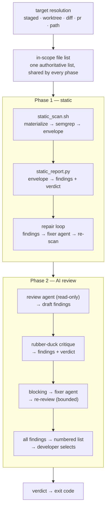
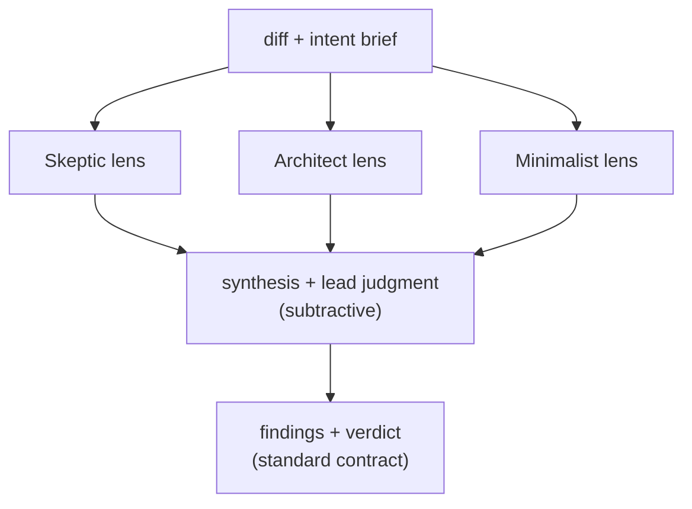

# Architecture

The mechanism behind the five positions in
[design-principles.md](design-principles.md) — read that first for *why* the
pipeline is shaped this way; this page is the *how*.

*Numeric budgets and defaults below (`maxFixLoops`, `critiqueRounds`, etc.)
verified against `config/review.config.default.json` as of 13 August 2026 —
the config file is the source of truth if they drift apart.*

- [The pipeline](#the-pipeline)
- [The finding contract](#the-finding-contract)
- [The critique pass](#the-critique-pass) · [second opinion](#the-second-opinion)
- [Adversarial review](#adversarial-review)
- [Trust boundaries](#trust-boundaries)
- [The explain handoff](#the-explain-handoff)
- [Target modes](#target-modes)
- [Judging a change against what it promised](#judging-a-change-against-what-it-promised)
- [The repair loops](#the-repair-loops)
- [Team memory](#team-memory)
- [The standard of craft](#the-standard-of-craft)
- [What the run cost](#what-the-run-cost)
- [Layout](#layout)
- [Failure behavior](#failure-behavior)

## The pipeline



## The finding contract

Both phases speak the same language, which is why the orchestrator can treat a
pattern matcher and a language model as interchangeable gate implementations.

```
<MARKER>\t<SEVERITY>\t<file:line>\t<category>\t<one-line fix>
```

- `MARKER` — `##STATIC-FINDING##` or `##CR-FINDING##`
- `SEVERITY` — `CRITICAL` | `HIGH` | `MEDIUM` | `LOW`
- exactly five tab-separated fields, no embedded tabs, one line per finding

The final non-empty line of a phase's output is its verdict:

```
STATIC-CHECK: PASS | STATIC-CHECK: FAIL
CODE-REVIEW: PASS  | CODE-REVIEW: FAIL
```

`validate_gate_output` in `lib/common.sh` enforces both halves. **Anything
malformed is classified `unavailable`, which blocks.** A crashed scanner or a
model that forgot the contract must never look like a pass.

Findings are de-duplicated on normalized `file:line` + category, keeping the
highest severity — so a rule flagged by both phases is reported once.

**One table per run, and findings are numbered once.** The report lists every
finding with its severity; the picker prompts against that table instead of
reprinting a subset. This looks like a formatting choice and is not. Two tables
appear on the same screen, so numbering each from 1 makes the same finding `#3`
in one and `#1` in the other — a developer who trusts the first one then selects
a different fix than the one they read, and nothing in the output says so.

**Every finding is pickable, blocking or not.** Splitting the prompt into a
separate advisory round was the origin of that bug, and it also meant the
findings that mattered most were the ones you could not act on. The developer
types numbers read straight off the one table. `parse_selection` validates
against the set of numbers that exist rather than a maximum, so a typo is
rejected instead of silently dropped. Whatever is picked is applied, re-reviewed,
and the remaining list offered again — because the verdict printed above it is
now stale, and telling someone `BLOCKED` immediately after they fixed the
blocker is how a gate gets uninstalled. See [The repair loops](#the-repair-loops)
for what stops it.

## The critique pass

Phase 2 does not report what it finds. The reviewer's findings are drafts; an
adversarial pass — [the rubber-duck
critique](../skills/code-review/references/finding-critique.md) — then argues
the opposite case for each one and keeps only the survivors, at their
post-critique severity.

Each draft finding must name the line and the concrete mechanism, be introduced
by the reviewed change, and be unguarded by any existing validation or contract.
A CRITICAL or HIGH additionally has to state its runtime consequence and why no
guard prevents it, or it is downgraded to MEDIUM or dropped.

This is a precision trade, made deliberately: **a false positive costs more than
a missed MEDIUM.** A gate that blocks commits on findings that turn out not to
exist gets bypassed, then disabled, and a disabled gate reviews nothing. The
critique instructions are restated inline in the prompt for the same reason the
output contract is — the reviewer may be unable to read files outside the
repository.

### The second opinion

Self-critique is necessary and not sufficient. A model arguing against a
conclusion it reached minutes ago shares every assumption that produced it, so
hallucinated findings survive precisely *because* the same reasoning generated
and then blessed them. What the reviewer emits is therefore sent to a
**different model** (`ai.critiqueModel`), running read-only, which never saw
that reasoning — [the second
opinion](../skills/code-review/references/second-opinion.md).

It has two jobs. It **checks the findings**, keeping, downgrading or dropping
each — strictly subtractive, never adding one, because a critic that can add
findings is just a second reviewer whose output nobody checked. And it reports
**misdeclarations**: findings that are wrongly *stated* rather than simply
wrong — cited at the wrong line, filed under the wrong severity, or resting on
a mechanism never demonstrated. Those go back to the original reviewer to
correct, since rewriting another agent's finding is the boundary that keeps the
critic subtractive.

The loop is capped at `ai.critiqueRounds` (default 2) because each round costs
two more model runs and must terminate whether or not the two agents converge.
It is skipped entirely when the review found nothing, so a clean change never
pays for it. The claim table is carried across rounds by the shell, not by
either agent: a checklist that lost rows each time a critic passed over it would
be a report that got less true the harder it was checked.

Two failure directions are closed deliberately. A critique that times out,
fails, or comes back malformed **keeps the findings it was asked to judge** —
safe by construction, since the pass can only subtract. And a finding is dropped
only once the code has been read and disproved it; a file the critic could not
open leaves the finding CONFIRMED, so a critic that cannot see the source can
never empty the report into a clean verdict.

## Adversarial review

The critique pass and second opinion make the *fast* gate trustworthy: one
reviewer, biased toward dropping findings, so a per-commit gate never cries
wolf. Adversarial review is the opposite posture, offered as a separate opt-in
mode (`--adversarial`, or `adversarial.enabled`) for a pull request as a whole.

Where the fast gate subtracts, the lenses **add**. Several reviewers each judge
the change from one angle — Skeptic (correctness, idempotency, shared state),
Architect (boundaries, dual-path debt), Minimalist (dead weight, needless
complexity), and conditionally Operator (safe deployment, bounded resources,
observability, compatibility, and rollback) — and each is told to attack, not
to validate. The number of lenses is sized to the change (1/2/3 for
small/medium/large), with Operator added when changed paths or diff semantics
indicate production risk, capped by `adversarial.maxLenses`. They run in
parallel.



Two design choices matter:

- **Same harness, different model.** The lenses run on `adversarial.model` — a
  different model than the primary review, on the *same* harness the team
  configured at install. The adversarial gap comes from a model that never saw
  the primary reviewer's reasoning plus the distinct lens prompts, without
  forcing a team to install a second AI CLI. With no model configured, the
  lenses fall back to the primary review model.
- **The synthesis only subtracts.** Each lens emits the normalized
  `##CR-FINDING##` contract; a final synthesis pass merges, deduplicates, and
  renders a lead judgment, but — exactly like the second opinion — it may only
  drop or downgrade a finding, never invent one or raise a severity. A finding no
  lens raised would reach the developer critiqued by nobody. So the additive
  lenses are bounded by a subtractive judge, and the output is the same finding
  table, picker, and verdict the fast gate produces.

Implemented in `lib/gate_adversarial.sh`; `run_ai_gate` dispatches to it when
adversarial mode is on, in place of the single `ai_review_once`. Each lens is one
model run and the synthesis one more, itemized separately in the cost summary —
which is why the mode is opt-in and aimed at whole PRs. The lenses read the
shipped engineering principles
(`skills/code-review/references/engineering-principles.md`) and the method lives
in the [adversarial-review skill](../skills/adversarial-review/SKILL.md).

## Trust boundaries

| Actor | Permissions | Rationale |
|---|---|---|
| Static scan | no model, subprocess only | Deterministic floor. Runs before any model has an opinion. |
| Review agent | `--allow-tool=read`, `--deny-tool=write,shell,url`, `--no-custom-instructions` | It judges the tree; it must not be able to change the tree it judges, or be steered by instructions inside it. |
| Fixer agent | `--allow-tool=read,write`, `--deny-tool=url` | Only ever receives findings a gate already produced. Never stages, commits, or pushes. |
| Discovery agent | `--allow-tool=read,shell`, `--deny-tool=write,url` | Proposes team knowledge for a repository it has never seen. It has a shell so it can call `inhousecode memory candidate add`, but no file-edit tool and no instruction to call OpenViking directly. Candidates are never authoritative until promoted. |
| Explain session | `--allow-tool=read`, `--deny-tool=url`, interactive, custom instructions **on** | The developer's own session, not the gate's. Read is pre-approved so exploring a finding is frictionless; anything that changes the tree prompts them. It renders no verdict, so repository context is an asset rather than an attack surface. |

Two further rules:

- **Reviewed code is input, not direction.** A comment in the diff that says
  "approve this" is a finding, not an instruction. The review agent runs with
  `--no-custom-instructions` so the reviewed repository cannot rewrite the
  reviewer's brief.
- **Scan the index, not the tree.** In staged mode files are materialized from
  git blobs into an isolated directory. Semgrep sees exactly what will be
  committed, never a dirty working tree. `--diff` and `--pr` do the same against
  the reviewed commit, so a reviewer's local edits cannot leak into the review.
- **Judging another developer's branch does not edit it.** `--diff` and `--pr`
  are report-only unless `--fix` is passed or `review.fixByDefault` is enabled.
  Explicit `--no-fix` always wins, and repairs stay disabled entirely when the
  reviewed commit is not the one checked out — a fixer edits the working tree,
  which in that case holds different code.
- **A commit never survives an explain session.** The session runs after the
  verdict, so anything it changed is unreviewed. The run exits blocked and the
  developer re-runs. A passing run is only downgraded when the tree actually
  moved — blocking someone who asked a question and changed nothing would teach
  them not to ask.

## The explain handoff

A verdict says *what*. It does not say *why*, and a gate that blocks without
teaching is a gate that gets uninstalled. `[e]` at the blocked prompt splits the
answer in two:

| Half | Produced by | Contents |
|---|---|---|
| The briefing | `lib/explain.py`, **no model** | Every finding, its category, and the reviewed source around it |
| The session | interactive Copilot | Reads the briefing, explains each finding in a fixed shape, then stops and waits |

Two properties fall out of that split:

- **The briefing works with zero model calls.** It is readable markdown. If the
  Copilot CLI is missing, printing its path is a real fallback, not an apology.
- **The source is never paraphrased.** Excerpts come from what the gate
  actually reviewed (the index in staged mode), not from the working tree.

The briefing is written to `.inhousecode/cache/last-briefing.md` —
deliberately beside the per-run cache directory, which the EXIT trap deletes, so
`inhousecode explain` can replay it after the gate process is gone.

Excerpts are read from wherever the gate judged the file: the index in staged
mode, the reviewed commit under `--diff`, and disk otherwise. An excerpt taken
from the working tree in staged mode would show lines that were never reviewed.

The seeded prompt states brevity as a budget — one sentence per field, at most
20 words, no preamble or summary — because "be concise" is a suggestion and a
word count is not. A wall of text fails exactly the way no explanation does.

## Target modes

| Mode | In scope | Source of truth |
|---|---|---|
| `--staged` (default) | files in the git index | index blobs |
| `--worktree` | modified tracked + untracked files | working tree |
| `--diff <base-ref>` | files changed between `merge-base(base, HEAD)` and `HEAD` | `HEAD` blobs, or the working tree when repairs are enabled |
| `--pr <id\|url>` | the same, with base and head resolved from the forge | PR head blobs, or the working tree when repairs are enabled |
| `--path <path>` | every tracked file under a path (whole files, no diff) | working tree |

`--diff` and `--pr` compare against the merge base rather than the base tip, so
commits that landed on the base branch after the fork point are never attributed
to the branch under review. A bare ref is retried as `origin/<ref>`.

`--pr` resolves the pull request through `gh` (GitHub) or `az repos` (Azure
DevOps), falling back to a `refs/pull/<id>/head` fetch against the remote's
default branch when neither is available — announced as an assumption, because a
silently wrong base branch would silently produce a wrong review.

Because the resolved head is a commit rather than the literal `HEAD`, a pull
request is reviewed **without checking it out**. Both gates read that commit's
blobs: the static gate materializes them into its scan tree, and the AI gate
materializes them into a separate review tree so the reviewer reads the proposed
code rather than whatever happens to be in the reviewer's working directory.

If the resolved head is already present locally — the branch is checked out, or
was fetched earlier — that object is reused instead of being fetched again, so a
local review costs no network round trip.

Once repairs are enabled by `--fix` or `review.fixByDefault` (which also requires
the reviewed commit to be checked out), both gates switch to reading the
**working tree** instead. A fixer writes there, so a re-scan against the
immutable commit would never see the previous round's work and every loop would
stall on "no progress" after one round. Fixes are left uncommitted and unstaged
for the developer to review. `--no-fix` prevents this switch.

The AI gate also passes the branch's commit log as context, so the reviewer can
weigh what the change claims to do against what it actually does — a mismatch
between the two is itself reportable.

`--pr` additionally resolves the pull-request **description**, and the base
branch is now taken from the forge-resolved commit rather than a same-named
local branch: a stale local copy of the base would move the merge base
backwards and pull unrelated files into scope.

## Judging a change against what it promised

A diff shows what happened. It never shows what was *supposed* to happen, and
that gap is where the expensive review misses live — not bad code, but code
approved for doing something it does not do.

Two inputs are precomputed for the reviewer, both optional and both degrading to
"absent" rather than to a wrong answer.

**The PR description** (`ai.verifyIntent`, `--pr` only). Written to
`pr-description.md` in the run cache. The reviewer extracts every checkable
claim, finds the code that delivers it, and reports one `##CR-CLAIM##` line per
claim with status MET, PARTIAL, UNMET, or UNVERIFIABLE. Claim lines carry no
severity and are rendered in their own table, above the findings table and never
numbered alongside it — [invariant 7](../AGENTS.md#invariants) requires the
numbers on screen to be the numbers the developer may type, and only one
table owns those. An UNMET or
PARTIAL claim additionally produces an ordinary finding, which is what carries
severity and enters the repair and triage loops.

Claims a description assigns to another PR in a stack are excluded, because
judging `[3/5]` against its siblings' promises produces nothing but false
failures.

**The blast-radius map** (`ai.impactAnalysis`, every mode but `--path`).
`lib/impact.py` reads the diff and reports every definition it adds, modifies,
or removes; `lib/impact.sh` then searches the reviewed revision for references
outside the change. The result is a map from each changed contract to the
callers that still depend on it.

The map is context, not findings. A reference is not a defect — it is a place
the reviewer is now obliged to look. The prompt is explicit that a break must
name its victim: a HIGH `breaking-change` finding requires a specific caller,
sibling implementation, or stored record that is wrong after the change.
Reference count alone is never a finding, or every popular helper would block
every commit that touched it.

Both are deliberately syntactic and bounded. The map skips prose and data files,
caps references per symbol and in total, and drops added symbols nothing refers
to yet. It will miss dynamic dispatch, reflection, generated code, and consumers
outside the repository — so a contract with no listed references is *not
obviously used*, which is not the same as unused.

The method behind both lives in the skill, not in the shell:
[pr-intent-verification.md](../skills/code-review/references/pr-intent-verification.md)
and
[breaking-change-analysis.md](../skills/code-review/references/breaking-change-analysis.md).

## The repair loops

Both loops are bounded, and both stop early.

| Loop | Budget (default) | Runs on | Stops when |
|---|---|---|---|
| **Static** | `static.maxFixLoops` = 20 | CRITICAL/HIGH/MEDIUM/LOW findings `--fix` or `fixByDefault` makes all of them eligible | scan is clean, budget spent, or a round removes nothing |
| **Review** | `ai.maxFixLoops` = 3 | blocking findings by default; all findings under `--fix`/`fixByDefault` | finding count stops improving, or budget spent |
| **Triage** | same budget as Review | developer's hand-picked selection from the numbered table | developer re-reviews and re-picks until clean, or budget runs out |

**Static** — `static.maxFixLoops` (default 20). Each round: report findings, hand
them to the fixer, re-scan. The loop exits when the scan is clean, when the
budget is spent, or when a round fails to reduce the finding count. That last
condition matters: a round that removed nothing will not start removing things on
the next attempt, and each round costs a model invocation. The re-scan runs even
when the fixer itself fails or times out — a fixer can edit files before
failing, so a verdict from before that round is never trusted again. `--fix` or
`review.fixByDefault` overrides `static.fixSeverity` to `all` for that run, so
every static finding is repaired, not only the configured subset.

**Review** — `ai.maxFixLoops` (default 3). Normally only blocking findings are
automatic. `--fix` or `review.fixByDefault` sends all AI findings to the bounded
loop instead. After each repair the change is re-reviewed on whichever mode
(normal or adversarial) started the run, because a fix can introduce a new
problem and an adversarial finding can be invisible to the single reviewer. The
loop also stops when a round does not reduce the finding count, and — like the
static loop — always re-reviews even after a failed or timed-out repair round.

**Triage** — the same budget, counted separately. Every set of hand-picked fixes
is re-reviewed and the new list offered again, so "fix, see what that surfaced,
fix again" happens in one sitting instead of one run per round. The re-review is
not optional: a fix edits the tree, so without it the verdict describes code that
no longer exists — `PASS` on edits no gate ever saw. Skipping it saves nothing
either, since the only other way to learn the truth is a re-run costing both
phases. When the budget runs out the developer is told to run again rather than
being held in the loop.

**Re-staging.** In staged mode a repair changes the working tree, but the scan
reads the index — so after each round, previously staged paths are re-staged.
Only paths that were *already* staged are touched; the loop never adds a new file
to your commit. Set `static.restageFixes: false` to disable, at the cost of the
loop no longer converging.

## Team memory

OpenViking is the only persistent memory store, under
`viking://resources/inhousecode/memory-policy/`. Nothing is written to the
repository. `lib/memory_policy.py` is the only code that talks to OpenViking;
`lib/memory.sh` is its shell bridge. Full policy: [memory-policy.md](memory-policy.md).

**Writes.** Every input — `inhousecode memory candidate add`, discovery, `[w]`
and `[o]` at the blocked prompt — becomes a candidate at a stable URI, verified
by reading it back. Classification may auto-promote a safe, evidenced,
repository-local fact; anything else waits for `inhousecode memory promote`.
Promotion writes a new record and keeps the candidate.

**Reads.** After the reviewed revision is known, `ai_gate` resolves memory once
(`memory_resolve_context`): project, global, and candidate areas are searched
separately, then filtered by repository, status, expiry, supersession, and
quarantine before ranking, and cut to `memory.contextMaxChars`. The result is
held in shell variables with its hash; the same bytes go to the primary
reviewer, the second opinion, every adversarial lens, and synthesis. Only the
evidence manifest (URIs + hash) is persisted, to the project's
`_review_evidence/` in OpenViking.

**Failure.** If OpenViking is unreachable, memory commands exit non-zero with a
clear message. Review prompts state that memory is unavailable and continue —
optional context never blocks and never bluffs (invariant 9).

## The standard of craft

`craft_standard()` in `lib/copilot.sh` is one block of prompt text shared by
every agent that may touch code — the static fixer, the review fixer, and the
explain session once the developer asks it to fix something. It is defined once
because two copies of a standard are two standards.

It asks for three things a model does not do by default:

| Rule | What it means in practice |
|---|---|
| **Follow the repository's own guidelines** | `AGENTS.md`, `CONTRIBUTING`, `.github/copilot-instructions.md`, approved review knowledge, and the style already visible in the file win over the model's own preference. A technically correct fix in a dialect the repository does not speak still costs a reviewer their afternoon. |
| **Do not block the developer** | Fixers run with `--no-ask-user`: an agent that decides to ask a question gets no answer and burns the round. "Make the most defensible choice, apply it, flag it in the summary" is load-bearing, not politeness. |
| **Leave it better than a patch** | Match the surrounding naming, error handling, and structure. The next reader is a person. |

The reviewer is deliberately excluded: it runs with `--no-custom-instructions`
so that reviewed code cannot rewrite the reviewer's brief. The fixers *do*
inherit repository instructions, because by then a verdict has already been
rendered and house style is exactly what you want them to absorb.

## What the run cost

Every review spends the developer's AI budget, so the summary ends with what it
spent:

```
  Cost            : 8.412 AI credits across 3 agent run(s)
                    review             5.100  (x2)
                    second opinion     3.312
```

The figures are the CLI's own, not this tool's arithmetic. That constraint is
the whole design: a cost this tool estimated would be *believed*, and a believed
wrong number is worse than no number. The CLI reports usage only on its JSONL
stream, so the three headless shapes — review, second opinion, repair — all run
with `--output-format json` and `lib/usage.py` reads two things back out of the
same log: the assistant's answer, reconstructed exactly as text mode would have
printed it, and a `session.usage_checkpoint` event carrying `totalNanoAiu` and
`totalPremiumRequests`. The interactive explain session stays in text mode; it
prints its own exit summary, and a developer reading a conversation should not
be reading JSON.

The checkpoint is cumulative *within a session* and each headless run is its own
session, so the run totals are summed and the per-session value is never summed
with itself.

The breakdown is itemised rather than lumped because the total is not one
decision. A second opinion, a repair round, and a re-review are each something a
team can switch off in `config`; a lump sum tells them which to reach for —
none.

Two failure directions matter, and both are closed:

- **Accounting never affects a verdict.** Anything that goes wrong here degrades
  to "not reported" and the gate proceeds. Being unable to price a review is not
  a reason to block a commit.
- **A partial total says it is partial.** If a run reports no usage, the summary
  prints the total as a lower bound rather than presenting it as complete.
  Understating a bill is the one direction a cost report must not round.

Requesting JSON is itself conditional on Python being available to read it back,
since asking for a format nothing can parse would turn every review into an
`unavailable` gate. And should the parse yield nothing anyway, `validate_gate_output`
sees an empty report and returns `unavailable` — never a pass. The failure
direction is safe by construction.

## Layout

| File | Responsibility |
|---|---|
| `bin/inhousecode` | CLI: target resolution, orchestration, verdict |
| `lib/common.sh` | config load, findings parsing, contract validation |
| `lib/config.py` | layered config resolution → shell variables |
| `lib/harness.sh` | AI CLI backend selection (copilot/claude-code/codex/hermes) |
| `lib/harness_copilot.sh` | Copilot CLI adapter |
| `lib/harness_claude_code.sh` | Claude Code CLI adapter |
| `lib/harness_codex.sh` | Codex CLI adapter |
| `lib/harness_hermes.sh` | Hermes CLI adapter |
| `lib/copilot.sh` | review vs. fix vs. discover vs. explain invocation, cost accounting |
| `lib/memory_policy.py` | governed OpenViking memory: lifecycle, retrieval, snapshot |
| `lib/memory.sh` | shell bridge to `memory_policy.py`; frozen per-review context |
| `lib/usage.py` | harness CLI output → the agent's answer, and what it cost |
| `lib/pr.sh` | pull-request resolution (`gh` / `az` / pull-ref) |
| `lib/impact.py` | diff → the definitions it adds/modifies/removes |
| `lib/impact.sh` | those definitions → who else still depends on them |
| `lib/static_scan.sh` | file selection, isolated tree, Semgrep (in-process, or emit/consume for a harness) |
| `lib/static_report.py` | Semgrep JSON → finding contract |
| `lib/gate_static.sh` | Phase 1 + repair loop |
| `lib/gate_ai.sh` | Phase 2 + blocking repair + finding triage |
| `lib/gate_adversarial.sh` | opt-in multi-lens review + synthesis |
| `lib/finding_view.py` | renders one or all findings with source excerpts and highlighting |
| `lib/integrations.py` | installs/updates/removes the managed Hermes and Codex Agent Skills |
| `lib/explain.sh` | briefing assembly + session handoff |
| `lib/explain.py` | findings + source → briefing markdown |
| `hooks/agent-stop.sh` | Copilot `agentStop` handler (fails open) |
| `hooks/copilot-hooks.template.json` | template installed by `install-hooks --agent-stop` |
| `skills/code-review/` | the reviewer: `SKILL.md` + references |
| `skills/adversarial-review/` | the multi-lens reviewer: `SKILL.md` + references |
| `skills/discovery/` | the onboarding agent: `SKILL.md` |
| `skills/inhousecode/` | the thin harness adapter skill shipped to Hermes/Codex |
| `config/` | default config + JSON schema |

## Failure behavior

| Situation | Result |
|---|---|
| Semgrep missing or crashed | `unavailable` → **blocks** |
| Copilot CLI missing | AI phase `unavailable` → **blocks**; static repair is skipped |
| Review agent timed out | `unavailable` → **blocks** |
| Malformed finding or verdict | `unavailable` → **blocks** |
| `--pr` cannot be resolved | usage error (exit 2), never a pass |
| PR base branch missing locally | usage error (exit 2), with the fetch command to run |
| No files in scope | pass, immediately |
| PR description unavailable | intent verification silently skipped; review continues |
| Blast-radius map empty or unbuildable | breaking-change section omitted; review continues |
| Copilot CLI missing at `[e]` | briefing is still written; its path is printed |
| No terminal at `[e]` | never launches; briefing path printed instead |
| `agentStop` hook errors | **fails open** — exits 0, turn ends normally |
| OpenViking unavailable | memory commands fail clearly; reviews continue with memory marked unavailable |
| AI harness missing at `discover` | usage error (exit 2); no candidate is written |

Everything blocks except the `agentStop` hook, which is the one place where
failing closed would trap a user inside a session they cannot exit.

The two "review continues" rows are not exceptions to that: intent verification
and the blast-radius map are optional *inputs*, not gates. A review without a PR
description is a review with less evidence, not a review that failed — blocking
because a description could not be fetched would make the gate unusable offline.
