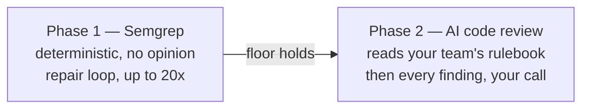

# Design principles

The reasoning behind the shape of the pipeline — why static comes before AI,
why findings split by severity, why there are two ways to trigger a review.
For the pipeline's mechanics, see [architecture.md](architecture.md); for the
one-paragraph version of all of this, see [concept.md](concept.md).



## Five positions

Most code is now written by an agent, which broke a second assumption on top
of the volume problem: **the reviewer is now the same kind of thing as the
author.** Teams review AI code with AI, which is fine — but if the only check
is "ask a model if this looks okay," the whole safety net is one more thing
that can hallucinate. A model that would have missed the bug can miss it
again wearing a reviewer's hat instead of an author's.

inhousecode is built around five positions on that:

| Position | How inhousecode applies it |
|---|---|
| **A deterministic floor comes first** | Semgrep runs before any model opines — no context window, no temperature, nothing to talk it out of a finding. It catches injection, unsafe deserialization, hard-coded credentials: the class of bug generated code reproduces constantly. The AI phase only ever reviews code that already cleared this. |
| **Findings are useless; fixes are the product** | A gate that prints twelve problems and stops has moved work, not removed it. Phase 1 loops findings to a fixer agent, re-scans, and repeats — up to 20 rounds, stopping the moment a round makes no progress. You come back to clean code, not a list. |
| **Severity decides who's in charge** | **CRITICAL/HIGH** are fixed automatically, then re-reviewed — not opinions, so approving the fix would just waste your attention. **MEDIUM/LOW** are listed, numbered, and left to **you** — those are opinions, and an agent that silently restructures your code because it prefers a different shape isn't reviewing, it's editing. |
| **Blocking without explaining is just friction** | A verdict tells you *what*, rarely *why*. A blocked commit offers `[e] explain` next to override/abort — an interactive session that quotes the exact rule violated, shows the offending lines, then **stops and asks you** what to do, before anything is fixed. |
| **Your team's knowledge has somewhere to live** | `.inhousecode/developer-rulebook.md` is a plain file your team owns, re-read on every run, cited by name in every finding — the difference between a generic reviewer and *yours*. This is the whole reason for the name: rules declared **in-house**, not shipped in from a vendor's idea of clean code. |

A rulebook entry is one line:

```markdown
- tenant-scoped-queries (sql) — every query filters by tenant_id
- no-print-logging (python) — use logging, not print(), in library code
```

## Two triggers — pick either, or both

| Trigger | Fires on | What happens |
|---|---|---|
| **Pre-commit** (default) | `git commit` | Both phases run against staged changes. You don't commit until it's clean or you deliberately override. |
| **Agent-stop** | Copilot CLI's `agentStop` hook, the moment your agent finishes a turn | The hook **refuses to let the turn end** and hands findings straight back to the *same* agent, context still loaded — fixed before you ever see it. No second model, no diff to re-explain. Bounded to 20 turns/session. |

Agent-stop runs the static phase only by default — fast, cheap, fires many
times a session. Enable the AI phase there too with `agentStop.ai: true`.

## Trust boundaries

Both phases speak one contract — a tab-separated finding line and a single
verdict — so the orchestrator treats a scanner and a model identically. A
malformed report is **unavailable**, never a pass: neither a crashed scanner
nor a confused model can wave a commit through.

| Component | Access |
|---|---|
| Review agent ([Copilot skill](../skills/code-review/SKILL.md)) | Read-only — judges the tree, cannot write to it |
| Fixer agent | Write-enabled, but only ever acts on findings a gate already produced |
| `[e]` explain session | Interactive, yours, pre-approved only for reading |
| Instructions found *inside* reviewed code | Treated as input, never as direction |

Full pipeline and the finding contract: [architecture.md](architecture.md).
