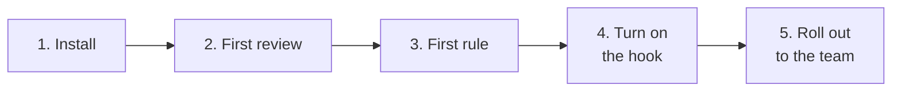

# Getting started

Five short pages, meant to be read in order the first time a team adopts
inhousecode. Each one ends where the next begins.

| Page | Covers | You'll have afterward |
|---|---|---|
| [1. Install it](01-install.md) | Prerequisites, the installer, `inhousecode doctor` | The `inhousecode` command working on your machine |
| [2. Run your first review](02-first-review.md) | `inhousecode review --worktree`, nothing installed into git yet | Seen the two-phase verdict once, on purpose |
| [3. Write your first rule](03-first-rule.md) | `memory candidate add` → `classify` | One team comment the reviewer now enforces |
| [4. Turn on the hook](04-turn-on-the-hook.md) | `install-hooks --pre-commit` / `--agent-stop` | Review running automatically, not by hand |
| [5. Roll it out to the team](05-roll-out-to-the-team.md) | The adoption order that keeps trust | A gate that stays turned on past week two |

If you just want the "why" before any of this, read
[docs/concept.md](../concept.md) first. If you want the full reference
instead of the guided version, the [README](../../README.md) and
[docs/configuration.md](../configuration.md) /
[docs/team-customization.md](../team-customization.md) have it.

Page 2 also introduces `inhousecode discover`, which proposes candidate
knowledge from the repository. Durable knowledge is stored only in OpenViking;
`.inhousecode/` contains configuration and transient cache, never memory
records.

Page 5 also introduces **adversarial review** (`inhousecode review --pr N
--adversarial`) — the deeper, multi-lens pass you run on a whole pull request
before it merges, as the counterpart to the fast commit-time gate.
