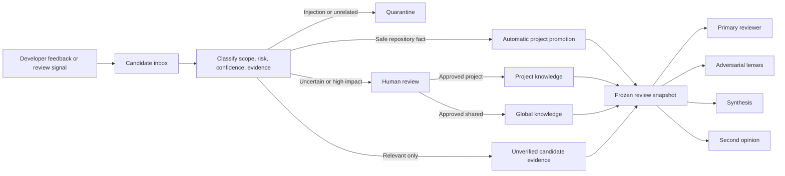

# Memory policy

inhousecode uses OpenViking as its only persistent memory store. Review knowledge
is shared, governed, scoped, and auditable. No memory record is stored in the
repository.

## Why this helps a team

Without memory, every review starts from generic engineering knowledge. With
memory, a team can teach future reviews facts such as:

- `payments-service` requires an idempotency key before retrying a charge;
- the legacy `/v1/export` route must remain until customer `ACME-42` migrates;
- all services use the shared `tenant_scope()` helper for tenant isolation;
- a rejected finding was correct for most repositories but false for this one.

The value is not that the model remembers more text. The value is that the same
approved, repository-scoped evidence reaches the primary reviewer, every
adversarial lens, synthesis, and the second opinion. A snapshot hash makes the
verdict reproducible.

## Authority boundary

Three things remain separate:

1. The code-review and adversarial skills define stable method, safety,
   severities, lens responsibilities, and output contracts.
2. OpenViking records hold variable team, project, architecture, and business
   knowledge.
3. `AGENTS.md` and tool-specific instruction files control how an agent works;
   they are not review-policy databases.

Memory cannot rewrite the adversarial skill. A candidate that proposes a new
lens, weaker safety rule, severity change, or canonical skill change always
requires human review and a normal versioned code change with tests. This avoids
letting retrieved content silently change the judge.

## Canonical namespace

```text
viking://resources/inhousecode/memory-policy/
├── _schema/
├── global/
├── projects/
│   └── <encoded-repository-id>/
│       └── _review_evidence/
└── candidate_memory/
    ├── inbox/
    ├── classified/
    └── quarantine/
```

Do not use these namespaces for inhousecode policy:

```text
viking://user/default/memories/
viking://user/default/resources/memory-policy/
viking://agent/skills/
```

Repository IDs come from the Git remote when available and are encoded with
reversible unpadded Base64URL. Machine-local checkout paths are not identities.

`.inhousecode/` may hold configuration and transient run output. It must not
contain `MEMORY.md`, `memory-policy/`, JSON/YAML memory databases, or a local
fallback. If OpenViking is unavailable, memory commands fail clearly. Reviews
continue with an explicit “memory unavailable” marker because optional context
must not masquerade as a gate.

## Lifecycle



Human-authored input also starts as a candidate. Authorship is provenance, not
proof. Promotion creates a new record and preserves the source candidate.

Automatic promotion is allowed only when all of these hold:

- target is one repository;
- confidence is high;
- repository evidence is present;
- no conflict was detected;
- the content is not security-sensitive;
- it does not alter review behavior or a canonical skill.

Global, security, cross-repository, conflicting, weakly evidenced, uncertain,
or reviewer-behavior changes require a human.

States are `candidate`, `classified`, `promoted`, `rejected`, `expired`,
`superseded`, and `quarantined`. Expired records remain stored but are not
active. `review_after` keeps a record visible while adding it to the
revalidation queue. Quarantine is never retrieved into a review prompt.

## Retrieval and precedence

inhousecode searches project, global, and classified candidate areas separately.
It applies policy filters before semantic ranking:

1. built-in safety and review contract;
2. approved project knowledge for the current repository;
3. approved global knowledge;
4. relevant candidates, labelled unverified evidence.

Scope, status, expiry, supersession, quarantine, and provenance are trust
controls. An embedding score is only a relevance signal.

The resolver runs once per review. It creates a bounded in-process snapshot with
record URIs, retrieval scores, filters, timestamps, and a content hash. The same
bytes reach the primary reviewer, adversarial lenses, synthesis, and second
opinion. Only the evidence manifest is persisted to OpenViking under the current
project; there is no local snapshot cache.

## Developer commands

Configure the `ov` CLI for the shared OpenViking server first. Keep credentials
outside the repository.

```bash
export OPENVIKING_CLI_CONFIG_FILE=/path/to/ovcli.conf
ov health

inhousecode memory init
inhousecode memory candidate add \
  "Payment retries require the shared idempotency helper." \
  --source developer-feedback \
  --evidence services/payments/retry.py:18

inhousecode memory classify <candidate-id> \
  --target project \
  --confidence high \
  --evidence services/payments/retry.py:18

inhousecode memory view \
  --prompt "What was added in the last 7 days about payment retries?"
```

For a high-risk candidate, classify it but do not auto-promote it. A maintainer
can make the explicit decision:

```bash
inhousecode memory promote <candidate-id> \
  --target project \
  --reason "Approved in architecture review ADR-42" \
  --evidence docs/adr/0042-payment-retries.md
```

## Learning from review sessions

OpenViking can learn experience from conversations. inhousecode feeds it review
outcomes and reads the result back as candidates. Opt in per repository:

```json
{
  "memory": {
    "recordSessions": true,
    "autoPromoteAfterReviews": 3
  }
}
```

**Record.** At the end of each review that had findings, an override, or a
recorded preference, inhousecode writes one OpenViking session and commits it:
what was flagged then fixed, what stayed open, and any override reason. A clean
review writes nothing. A failure prints one warning and never changes the
verdict.

Sessions belong to a dedicated OpenViking user, `inhousecode-<repo hash>` by
default (override with `INHOUSECODE_OV_SESSION_USER`; `default` is refused). So
OpenViking's extractor never mixes review lessons into a developer's personal
memories, and each repository's experience stays separate.

**Harvest.** `inhousecode memory harvest` reads each session archive's
`memory_diff.json` (OpenViking's audit log of what extraction added) and turns
new lines into candidates in `candidate_memory/inbox`:

- only the `cases`, `patterns`, `tools`, and `skills` categories; personal
  categories (profile, preferences, entities, events) are skipped;
- evidence is the archive URI and its `memory_diff.json`;
- prompt-injection-like lines go to `candidate_memory/quarantine`;
- candidate IDs are content hashes, so re-running creates nothing new, even
  after a candidate was classified;
- archives still being extracted are counted as pending and picked up later.

Harvested items always begin as candidates. A candidate may become project
knowledge automatically only when the same normalized lesson was extracted from
at least `memory.autoPromoteAfterReviews` separate reviews and every qualifying
review:

- fixed a finding at a `file:line` that still exists inside this repository;
- was not overridden; and
- has an inhousecode-owned outcome manifest tying the extraction to that review.

Security-related lessons, changes that suppress review findings, and anything
related to existing promoted knowledge remain classified for a human. A review
that fixed nothing does not count. Multiple extraction archives from one review
count once. Set `autoPromoteAfterReviews` to `0` to disable this path; `1` is
refused because one observation is not recurrence.

The original candidate remains after promotion and records every session,
archive, review ID, and code location used as evidence. OpenViking "skills"
knowledge becomes candidate text, never an edit to `skills/` or to the
adversarial reviewer.

**Schedule.** Extraction is asynchronous, so harvest on a schedule rather than
in the commit hook. Once a day is enough:

```bash
inhousecode memory schedule install            # daily 03:15; launchd on macOS, cron elsewhere
inhousecode memory schedule install --hour 7 --minute 0
inhousecode memory schedule status
inhousecode memory schedule uninstall
```

The job runs `inhousecode memory harvest` in the repository with your current
`PATH` and `OPENVIKING_CLI_CONFIG_FILE` (the path only, never secrets).
Re-installing replaces the job; uninstalling removes only that job. Logs go to
`~/Library/Logs/inhousecode/` (macOS) or `~/.inhousecode-logs/`.

## Local value demonstration

Use a disposable repository connected to the same configured OpenViking server:

```bash
inhousecode init

inhousecode memory candidate add \
  "This repository requires idempotency keys before retrying payment writes." \
  --source local-demo \
  --evidence payments/client.py:12

# Use the returned candidate ID.
inhousecode memory classify <candidate-id> \
  --target project --confidence high \
  --evidence payments/client.py:12

inhousecode memory view \
  --prompt "What repository rule applies to payment retries?"

ov tree viking://resources/inhousecode/memory-policy --all --level-limit 8
```

Then review a change that retries a payment without the helper. The normal and
adversarial prompts receive the same record URI and snapshot hash. Correct the
change to use the helper and rerun the review. The team value is visible when
the first review finds a repository-specific risk and the corrected review no
longer does, without adding any repository-local policy file.

## Research basis

The implementation borrows established ideas without delegating governance to a
model or storage provider:

- MemGPT separates bounded working context from external long-term memory:
  <https://arxiv.org/abs/2310.08560>
- Reflexion preserves feedback as episodic experience rather than overwriting
  it: <https://arxiv.org/abs/2303.11366>
- Generative Agents combines relevance, recency, and importance while retaining
  source experiences: <https://arxiv.org/abs/2304.03442>
- Self-RAG shows that retrieving a fixed top-k without checking relevance and
  support can reduce quality: <https://arxiv.org/abs/2310.11511>
- TempRALM shows that semantic similarity alone cannot resolve competing dated
  versions: <https://arxiv.org/abs/2401.13222>
- PoisonedRAG demonstrates why highly retrievable content is not automatically
  trustworthy: <https://arxiv.org/abs/2402.07867>
- W3C PROV motivates explicit entities, activities, agents, derivations, and
  immutable evidence bundles: <https://www.w3.org/TR/prov-dm/>

These sources support tiered memory, immutable evidence, temporal filtering,
selective retrieval, and provenance. The exact namespace, states, and approval
matrix are inhousecode governance decisions.
